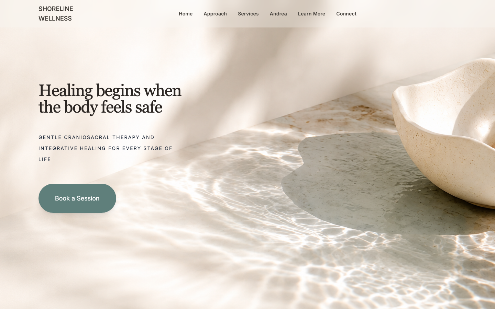

# Shoreline Wellness

**Live site: [timbyers.dev](https://timbyers.dev)**



A one-page website for a craniosacral therapy and integrative wellness practice. It's a **concept site designed for a real practitioner**: the services, approach and practitioner content are based on her real work, while the business name is made up for this project.

The site's job is to help visitors understand gentle, lesser-known therapies, build trust, and make it easy to book a session.

## Features

- **Responsive, mobile-first layout** with a fixed, frosted-glass navigation bar and a collapsible mobile menu
- **One-page navigation** that jumps to each section: Approach, Services, About the Practitioner, Learn More and Connect
- **Service cards** with image hover effects
- **Calm visual design:** a soft natural color palette, serif headings and plenty of white space, chosen to match the practice's tone
- **Automated deployment:** every push to `main` builds the site and deploys it to my own server

## Built with

- **HTML5** and **JavaScript (ES6+)**
- **Tailwind CSS v4** for styling
- **Flowbite** for interactive components (mobile navigation menu)
- **Vite** for development and production builds
- **GitHub Actions** for continuous deployment over SSH to a Linux web server
- A custom domain, **timbyers.dev**, that I set up and manage

## Process

I planned the site before writing code:

1. **[Milestone 1](documentation/milestone-1.html):** purpose, audience, goals and a user persona ("Jennifer," a busy teacher researching natural options for stress and tension)
2. **[Milestone 2](documentation/milestone-2.html):** content strategy for each section, plus desktop and mobile wireframes
3. **Build:** turned the wireframes into a responsive Tailwind layout, then refined the design and copy
4. **Deploy:** set up a GitHub Actions workflow that runs `npm run build` and copies the output to the server

## Run it locally

```bash
git clone https://github.com/tbyers007/shoreline-wellness-pwp.git
cd shoreline-wellness-pwp
npm install
npm run dev
```

## What I'd add next

- A working contact form
- A testimonials section
- Online booking integration

---

Built by **[Tim Byers](https://github.com/tbyers007)** as part of the CNM Deep Dive Web Development & AI Tools Bootcamp.
